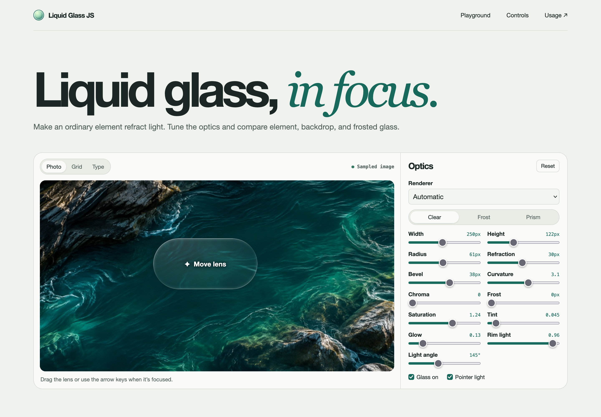
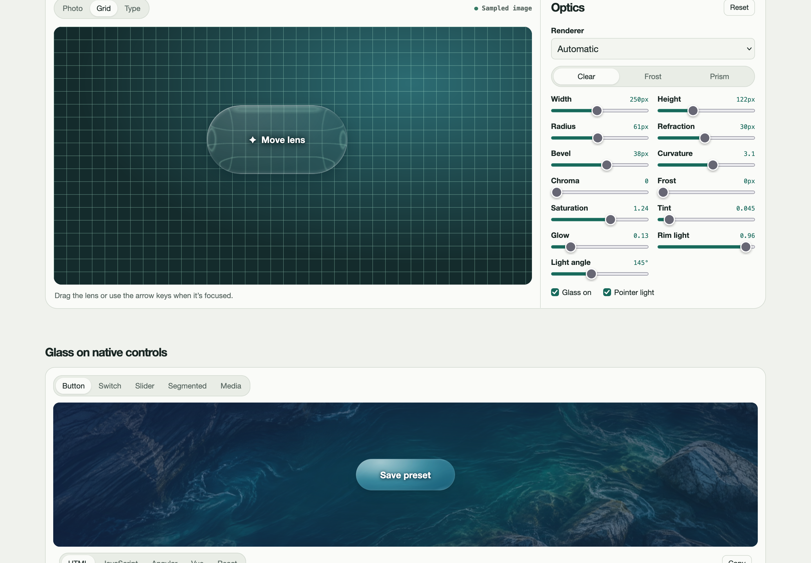

# Liquid Glass JS

A dependency-free glass material for ordinary HTML elements. It can bend the element’s own text, CSS and images, sample an image, canvas or video behind it, or refract the live page backdrop. Angular, React and Vue bind the same JavaScript core to their lifecycle.

## Playground

Try the [interactive demo on GitHub Pages](https://bigimattia.github.io/liquidglass-js/).





To run the playground locally:

```sh
mise trust
mise install
mise run dev
```

Open [the local playground](http://127.0.0.1:4173/demo/). Drag the lens or focus it and use the arrow keys. Compare the photo, grid and typography scenes and change the optical settings. Select Button, Switch, Slider, Segmented, or Media in the native-controls showcase to try the control and copy Tailwind HTML, JavaScript, Angular, Vue, or React source. The usage panel includes examples for all four entry points.

## Install

```sh
npm install @ikeofficial/liquid-glass-js
```

The package includes minified ESM and CSS, TypeScript declarations, and an [agent skill](skills/liquid-glass-js/SKILL.md). Frameworks are optional peers of their respective adapters. Installing the core alone adds zero dependencies. The playground and build tools use separate development dependencies.

## Publishing

The **Publish to npm** GitHub Actions workflow publishes `@ikeofficial/liquid-glass-js` to npmjs.com. Add an npm granular access token with permission to publish this package and bypass 2FA as the `NPM_TOKEN` repository secret under GitHub Settings → Secrets and variables → Actions. Do not commit the token. npm plans to remove direct publishing with granular tokens in January 2027; migrate to [trusted publishing](https://docs.npmjs.com/trusted-publishers/) before then.

Update the version in `package.json`, then run **Publish to npm** from the Actions tab. Each published npm version must be new. To build a local archive, run `mise run install` and `mise run pack`.

## License

[MIT](LICENSE)

## Plain JavaScript

```js
import { liquidGlass } from "@ikeofficial/liquid-glass-js";
import "@ikeofficial/liquid-glass-js/style.css";

const item = document.querySelector("#item");
const glass = liquidGlass(item, { mode: "content", radius: 30, refraction: 18 });

glass.update({ chroma: 0.2 });
glass.destroy();
```

The call returns a controller. Reapplying to the same element updates the existing controller. `update(options)` merges options. Use `update(options, { replace: true })` to reset omitted options. Call `destroy()` when the element unmounts. Read `glass.renderer` for the active renderer or listen on the host for `liquidglass:rendererchange`.

For plain HTML, copy the `src/` folder from the repository and serve it over HTTP. Load `liquid-glass.css` with a stylesheet link and import `liquidGlass` from the folder’s `liquid-glass.js` in a module script.

## Angular

Add `LiquidGlassDirective` to a standalone component’s imports and load the shared stylesheet globally, for example via your Angular workspace’s styles list. Angular 20 or later within the package’s peer range.

```ts
import { Component } from "@angular/core";
import { LiquidGlassDirective } from "@ikeofficial/liquid-glass-js/angular";

@Component({
  imports: [LiquidGlassDirective],
  template: '<button [liquidGlass]="{ mode: \'content\', radius: 22 }">Continue</button>',
})
export class Action {}
```

A bare `liquidGlass` attribute uses the defaults.

## React

```jsx
import { useLiquidGlass } from "@ikeofficial/liquid-glass-js/react";
import "@ikeofficial/liquid-glass-js/style.css";

export function Action() {
  const ref = useLiquidGlass({ mode: "content", radius: 22 });
  return <button ref={ref}>Continue</button>;
}
```

The hook returns a callback ref for a DOM element. In TypeScript, you can narrow it with `useLiquidGlass<HTMLButtonElement>()`.

## Vue

```vue
<script setup>
import { vLiquidGlass } from "@ikeofficial/liquid-glass-js/vue";
import "@ikeofficial/liquid-glass-js/style.css";
</script>

<template>
  <button v-liquid-glass="{ mode: 'content', radius: 22 }">Continue</button>
</template>
```

The directive can also be registered globally with `app.directive("liquid-glass", vLiquidGlass)`.

## Rendering modes

| Options | What bends | Browser behavior |
| --- | --- | --- |
| `{ mode: "content" }` | The host’s rendered pixels, including its CSS background and descendants | SVG element filter in Chromium, Firefox and WebKit |
| Default, or `{ mode: "auto" }` | Live page pixels when supported, otherwise the supplied backdrop | SVG refraction in Chromium, sampled media when supplied, then CSS frost |
| `{ mode: "backdrop" }` | Arbitrary page pixels behind the host | SVG refraction in Chromium. CSS frost in other engines. A supplied backdrop retains its sample-first behavior. |
| `{ mode: "sampled", backdrop: media }` | A supplied ``, `<canvas>`, or `<video>` behind the host | Shared WebGL renderer where available, with Canvas 2D fallback |
| `{ mode: "frost" }` | No displacement | CSS tint, blur and highlights where supported |

Use an ordinary HTML host with available `::before` and `::after` pseudo-elements. For content mode, put the artwork inside the host or use a CSS background. The filter refracts pixels only inside the lens silhouette. Use a decorative presentation layer for labels that must stay sharp, and keep the filtered host compact on mobile. The playground clips the aligned scene copy at the parent after refraction, so the glass outline stays stable as the optical settings change.

A sampled media element must sit visually behind the lens in the same document, axis-aligned, without padding or borders. Images and videos support `object-fit: fill` or centered `cover` or `contain`. Use a same-origin or CORS-enabled source. The library resamples on resize, scroll, and media load. Video uses `requestVideoFrameCallback()` when available. Call `glass.refresh()` after moving the lens programmatically or redrawing a canvas.

Automatic mode requires an explicit `backdrop` element for the sampled fallback. Use `mode: "sampled"` when the video or image should drive refraction on every browser. For the native-control snippets, load Tailwind CSS v4 and the shared glass stylesheet. The Media example also needs a same-origin video and poster, or a video served with CORS enabled and loaded with `crossorigin="anonymous"`.

The SVG modes use an internally generated PNG data URL. Where CSP disallows `data:` images, use a sampled backdrop or frost. Reduced motion disables pointer tracking. Reduced transparency and forced colors use a solid treatment. A CSS-only treatment is also available by applying the `liquid-glass` class with the shared stylesheet.

## Options

| Option | Default | Effect |
| --- | --- | --- |
| `mode` | `"auto"` | Auto, content, backdrop, sampled, or frost |
| `backdrop` | `null` | Optional image, canvas or video source for auto, backdrop, and sampled modes |
| `radius` | 24 | Corner radius in CSS pixels. Set size with your CSS |
| `refraction` | 18 | Requested edge displacement in CSS pixels, bounded by the lens size. Zero disables distortion |
| `bevel` | 24 | Width of the refracted edge in CSS pixels |
| `curvature` | 2 | Shape of the optical bevel, 0.25–8 |
| `chroma` | 0 | Color-channel spread, 0–1 |
| `blur` | 2 | Frost in CSS pixels |
| `saturation` | 1.35 | Color saturation multiplier |
| `tint` | 0.14 | Tint opacity, 0–1. Set `--liquid-glass-tint-rgb` as an RGB triplet |
| `glow` | 0.23 | Interior highlight opacity, 0–1 |
| `edgeHighlight` | 0.85 | Rim light intensity, 0–1 |
| `lightAngle` | 145 | Rim gradient angle in degrees |
| `interactive` | `true` | Pointer-tracking highlight |

## Agent skill

Copy [`skills/liquid-glass-js`](skills/liquid-glass-js) into your project’s `.agents/skills/` directory. Invoke `$liquid-glass-js` and provide a checkout or tarball path.

## References

The content-rendering approach draws on [Aave’s Building Glass for the Web](https://aave.com/design/building-glass-for-the-web) and the browser measurements reported by [gentpan/liquidglass](https://github.com/gentpan/liquidglass). The playground uses original generated photography.
